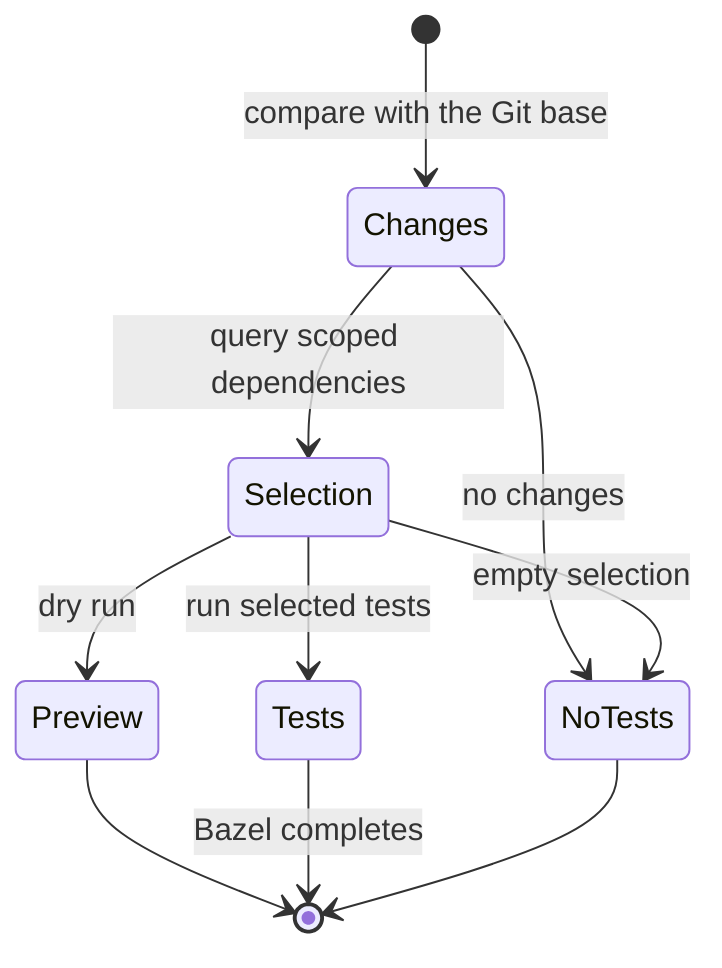
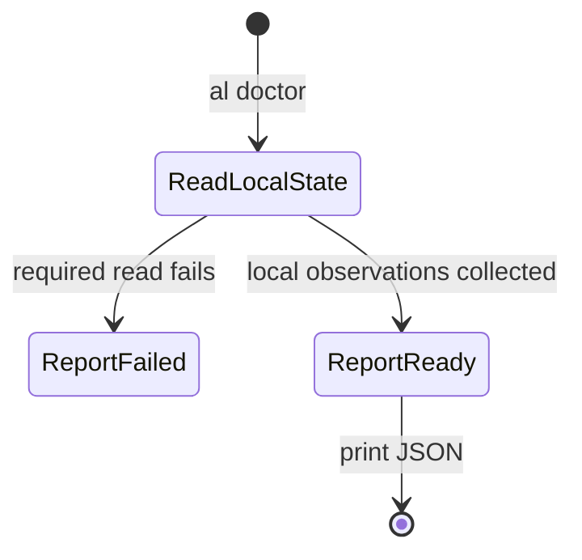

# Select affected tests and inspect local diagnostics

## Summary

`al bazel test` selects tests affected by Git changes against an explicit base.
It can preview that selection or run the selected tests. `al doctor` prints
local diagnostic JSON without launching Bazel. It describes
selected files and executable identity; it does not prove that a subsequent
build will succeed or that a host executable matches its declared pin.
Ordinary builds and tests remain available through `bazel`, with setup in the
[Bazel reference](../../bazel/README.md).

## The simple case

Run `al bazel test --base master --dry-run` from a workspace to inspect its
affected-test selection. Run without `--dry-run` to execute that selection.
Append a target pattern such as `//projects/example/...` to limit the test scope;
the default is `//...`.

Run `al doctor --workspace-root /absolute/workspace --task-scratch
out/task/run` to inspect local setup. The JSON identifies the running AL
executable, declared Bazel pin, platform, configured rc-file inventory,
built-binary comparison when available, and scratch-path classification.
No build or repair follows.

For a different workspace layout, select `--bazelisk-config PATH` and
`--source-binary PATH`; repeat `--rc-file PATH` to describe its rc inventory.
Include the absolute path of a user rc file explicitly when it matters to
the report. Doctor does not discover that file automatically.

## The interaction, event by event

### Invoke

The selector requires `--base REF` and absolute target patterns. It compares the
current work against the unique Git merge base, including committed changes,
staged edits, working-tree edits, and nonignored untracked paths.
`--workspace PATH` chooses a Bazel workspace, resolving relative paths from the
current directory. Otherwise
discovery starts from `BUILD_WORKSPACE_DIRECTORY` when set or the current
directory and finds the nearest Bazel workspace root. Selection belongs to
that workspace, independently of delivery preparation and receipts.

The operator chooses a workspace and optional input/scratch paths. Doctor
defaults to the current directory, reads `.bazeliskrc`, and reports `.bazelrc`
as its default rc inventory. Relative pin, source-binary, rc-file, and scratch
inputs resolve against the selected workspace root. Its options use separate
values, as shown in help.

### Exits immediately

The selector refuses a missing or invalid base or workspace, including a base
without one merge base with HEAD. A failed Bazel query fails selection without
printing a selection report or running tests; partial query output is not
accepted as a complete set. It accepts its selector options and target patterns, not arbitrary
Bazel commands or build/test option forwarding.

Help prints usage without gathering a report. Unknown options, missing option
values, unreadable required files, missing Bazel on PATH, or missing Bazelisk
pin fields fail the report. Doctor does not search upward for a different
workspace. Explicitly empty pin-file, source-binary, or rc-file values are
refused.

### Begins running

Bazel queries identify changed source inputs, their reverse dependencies, and
tests inside the requested scope. Deleted, unknown, configuration, or
outside-workspace paths widen selection to the full scope when a narrower set
cannot be established.
Changes in other nested workspaces require their own selected-workspace checks.
Wildcard scopes exclude root targets with the literal `manual` tag before
expanding test suites. An explicitly named test or suite remains eligible,
and an eligible suite retains its listed members, including manual-tagged
members. Bazel's configured test filters can further filter the selection.

AL reads local identity and the selected pin file, and resolves `bazel` from
PATH. A missing selected built binary makes the source comparison unavailable;
it does not prove that the installed binary is current. The report does not
execute Bazel to check its version or ask which rc files were actually loaded.

`--source-binary` selects the comparison file; otherwise the conventional path
from the [diagnostic reference](../../bazel/README.md#diagnostics) applies.
Successful comparison reports the resolved absolute path. Explicit `--rc-file`
values replace the default inventory and appear relative to the workspace when
possible. Doctor reports those declarations without reading or validating the
rc files, and does not claim that an agent profile is active.

### While running

The selector's dry run performs selection but skips tests. An unchanged
comparison needs no Bazel queries. Normal
execution runs the selected tests through Bazel with its usual configuration
and cache behavior. Narrowing selection excludes tests and work needed only by
them, so missing or evicted unrelated cache entries do not request unnecessary
rebuilds or reruns. The query itself still loads the requested graph. No measured
performance improvement is claimed.

Doctor collects one bounded report. It does not dump the environment, create
the selected scratch directory, or change an installation. Scratch
classification checks the path's shape, not whether the directory exists,
is writable, or is isolated from other users.

### Finishes

The selector prints one JSON report before test execution. The
[Bazel reference](../../bazel/README.md#test-affected-targets) owns its fields.
Query diagnostics and all test output go to stderr, leaving stdout as the
selection report. Test failures return nonzero even though that report already
exists. No changes or no selected tests succeeds without invoking tests.
A completed test invocation covers only the selected scope. It does not create a
delivery receipt, publish source, or prove that every affected workspace was
checked.

Doctor prints JSON on stdout and returns. An unavailable source comparison or
conflicting scratch path is a report field and does not itself make doctor
exit nonzero. Reading failures prevent the complete report and produce a
diagnostic instead.

## Modifiers

| Variant                       | Changes what happens                                                                                                     | Changes what is printed                                                                                                                |
| ----------------------------- | ------------------------------------------------------------------------------------------------------------------------ | -------------------------------------------------------------------------------------------------------------------------------------- |
| Arguments and flags           | Selector flags choose the base, workspace, scope, and dry run; doctor paths choose diagnostic inputs.                    | The selector reports its selection; doctor describes the selected inputs.                                                              |
| Environment and configuration | PATH selects Bazel; queries and tests use its configuration. Doctor reads the selected pin file without launching Bazel. | Selection reflects the current dependency graph; doctor reports declared identity and rc inventory without claiming effective options. |
| Terminal and streams          | Neither selection nor doctor requires a confirmation prompt.                                                             | Selection and doctor reports use stdout; query diagnostics and test output use stderr.                                                 |

Flags remain fixed. Neither command holds an immutable snapshot across all its
Git, workspace, or diagnostic reads.

## Cancel and interrupt

| Event                          | Before work                                                                     | During work                                                                      |
| ------------------------------ | ------------------------------------------------------------------------------- | -------------------------------------------------------------------------------- |
| Ctrl+C once or twice           | Uses the [invocation signal model](../foundations/invocation.md#interruption).  | The selector cancels its active Git/Bazel client; doctor may finish local reads. |
| SIGTERM                        | No completed selection, tests, or report is implied.                            | The selector cancels its active client; neither command rolls back state.        |
| Terminal closed (SIGHUP)       | No special AL recovery.                                                         | Output can stop before completion; inspect any running Bazel work.               |
| Input or output pipe closes    | Doctor does not read stdin; the selector forwards stdin to its test invocation. | Selection/report writing or test output can fail after earlier work.             |
| Network lost                   | Local Git and diagnostic reads remain local.                                    | Query/test services can fail; doctor remains local.                              |
| Disk full or file inaccessible | Missing inputs or required executables can fail setup.                          | Query/test outputs or report writing can fail; no complete result is implied.    |
| Required state changes         | Current PATH, Git refs, and selected workspace determine setup.                 | Queries and local reads have no shared immutable snapshot.                       |
| Concurrent invocation          | Each selects its workspace and executable independently.                        | Bazel owns its server coordination; AL maintains no shared result ledger.        |
| Forced kill                    | No completed observation is implied.                                            | A capture may be partial and Bazel outputs may remain; inspect before retrying.  |

Rerun selection when relevant source changes. Doctor has no persistent work to
resume; rerun it when local state changes.

## Interactions with other systems

**Configuration.** The [Bazel reference](../../bazel/README.md) owns setup and
installation. Test selection is independent of delivery and uses Bazel's
configuration. Doctor does not parse rc files. Neither starts `al run` plugins.

**Output.** Selection and test results describe the chosen scope. Doctor's JSON
differentiates an unavailable source comparison from an observed stale installation.

**Permissions.** Selection reads Git and source state and can run Bazel tests.
Doctor needs read access to selected local files; it does not grant or repair access.

**Concurrency.** Selection and diagnostics can see changing local files. Rerun
selection when the source or build graph changes; it is not a reserved test plan.

**Persistence and recovery.** Tests can leave ordinary Bazel outputs and caches.
There is no AL results ledger. Doctor changes no repository, installation, or
scratch directory and creates no receipt.

**Network.** Bazel queries and tests use their configured services. Doctor
resolves a path and reads local files without launching that executable or
contacting a service. Selector dry run still performs dependency queries.

## Edge cases

- Full-scope fallback is a conservative selection, not evidence that every test
  is affected. Tests outside the explicitly requested scope remain outside it.
- A query failure is an error even if the failed query printed some labels.
- A selection report is not proof that tests ran: dry run, an empty selection,
  caching, configured filters, or later test failure all affect execution.
- A build elsewhere remains unavailable to the default comparison; select its
  path explicitly with `--source-binary` to compare it.
- The rc list is configured inventory, not evidence of files actually loaded.
  An absent listed rc file can still appear in a successful report.
- A configured version pin is not an observation of the resolved executable's
  runtime version.
- An invalid scratch classification is reported with exit zero; callers must
  inspect the JSON fields they care about.
- There is no implicit installation update after a source change.

## Open questions and verification

- Sources: [report implementation](../../../internal/bazelcmd/main.go),
  [diagnostic fixtures](../../../internal/bazelcmd/main_test.go), and
  [built-CLI fixture](../../../cmd/al/lifecycle_e2e_test.go).
- Selector sources: [selection and execution](../../../internal/bazelcmd/test.go)
  and [TestAffectedBazelCLI](../../../cmd/al/bazel_e2e_test.go). Its
  `affected-bazel-tests.json` artifact uses real Git and AL with an instrumented
  Bazel process; it does not establish behavior against a real dependency graph.
- Doctor's namespaced and conflicting scratch classifications were observed in
  the earlier C1 pass. `TestDoctorConfiguration` exercises configurable input
  paths and copied-binary comparisons in an isolated workspace. These checks do
  not establish every workflow in another repository; terminal signals and
  broken pipes still require their own observations.
- Earlier forwarding observations describe a removed AL command and are not
  evidence for ordinary Bazel execution or the affected-test selector.
- Affected-test observations remain pending. No runtime pass or speedup is
  inferred from the source description.
- Checklist: [affected tests](../verification/commands.md#select-affected-tests).
- Checklist: [diagnostics](../verification/commands.md#inspect-local-diagnostics).

Verified against alwaldend/src commit `7cd4714139984bf4f9b2ae1de9189470b336e12e`.
