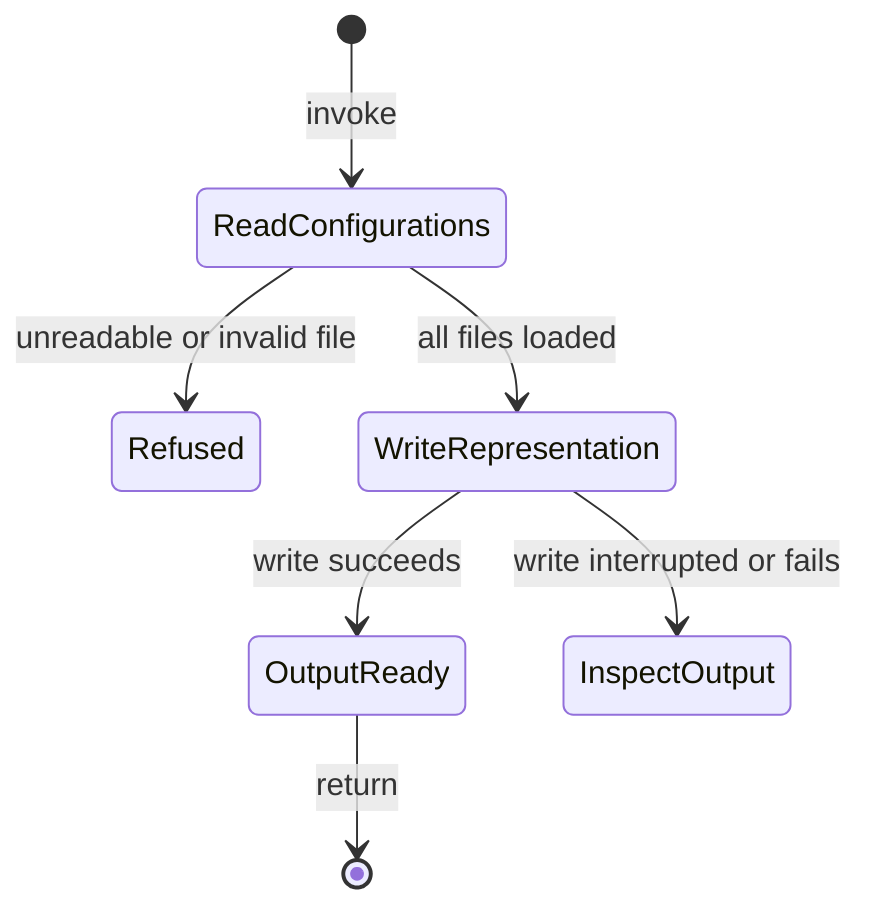

# Inspect configuration

## Summary

`al config dump` reads explicitly selected configuration files and shows their
merged contents as JSON. It can write that representation to a private file.
Inspection does not start plugins or prove that a selected plugin can run.

## The simple case

Run `al config dump --config /absolute/path/config.json`. AL prints the merged
configuration, then exits. Repeat `--config` to include more files in order.
Without any files, the result is an empty JSON object followed by a newline.

Use `--out /absolute/path/dump.json` to write a file instead. Read the file after
successful completion. The output can contain sensitive configuration values;
inspection does not redact the requested representation.

## The interaction, event by event

### Invoke

The operator supplies each file explicitly. AL does not search for a default
configuration or inherit `al run` flags. Accepted filename extensions are `.json`
and `.yaml`; `.yml` is not an alias. Lua inputs are rejected. `-c` and `-o` abbreviate `--config`
and `--out`. Relative paths use the invocation's working directory.

### Exits immediately

Help describes the flags. A missing file, unsupported extension, or invalid
configuration fails before the output file is opened. The diagnostic identifies
the file and failure stage without echoing invalid configuration values.

### Begins running

AL reads files in their supplied order. List entries accumulate in that order.
For example, plugins supplied in three files remain three entries in the dump;
dumping does not resolve duplicate plugin names into one selected plugin.

Use `--substitution MARKER=/absolute/path/public-file` to replace a marker
with the trimmed, JSON-escaped contents of a public build input before parsing.
Loading declarative files does not start the plugin definitions they contribute.

### While running

AL collects the complete representation before opening a requested output file.
There is no progress display or interactive editing phase. Once output writing
starts, an existing file is restricted to owner access and truncated. The write
does not use a separate replacement file; a failure can leave partial contents.

### Finishes

Success produces indented JSON and a final newline, either on stdout or at the
selected path. File output has mode `0600`, including when the file previously
had broader permissions. Failure to restrict, truncate, or write the file fails
the invocation. No plugin resources remain to clean up because none were started.

## Modifiers

| Variant                       | Changes what happens                                                                                  | Changes what is printed                                                                                |
| ----------------------------- | ----------------------------------------------------------------------------------------------------- | ------------------------------------------------------------------------------------------------------ |
| Arguments and flags           | Repeated configuration paths determine merge order; the output flag chooses a file instead of stdout. | The selected configuration is printed as indented JSON, or stdout stays empty when a file is selected. |
| Environment and configuration | Only explicit files are loaded; explicit public-file substitutions are applied before parsing.        | Substituted public file values appear in the requested dump.                                           |
| Terminal and streams          | No TTY or stdin is required for declarative files.                                                    | JSON uses stdout unless an output path is supplied; diagnostics use stderr.                            |

Arguments remain fixed during the invocation. Editing a source file while it is
being read is not an interactive configuration update.

## Cancel and interrupt

| Event                          | Before work                                                                                               | During work                                                                                                                 |
| ------------------------------ | --------------------------------------------------------------------------------------------------------- | --------------------------------------------------------------------------------------------------------------------------- |
| Ctrl+C once or twice           | Uses the [invocation signal model](../foundations/invocation.md#interruption); a cancelled load can fail. | Cancellation is checked before each configuration read; file reads and output writes do not promise immediate interruption. |
| SIGTERM                        | Requests cancellation before another configuration load.                                                  | There is no automatic restoration of an output already truncated.                                                           |
| Terminal closed (SIGHUP)       | No special AL recovery.                                                                                   | An output already being written can remain partial.                                                                         |
| Input or output pipe closes    | Declarative configuration comes from named files, not stdin.                                              | A closed output stream can stop the write; no complete JSON result is promised.                                             |
| Network lost                   | No effect for ordinary local JSON or YAML inputs.                                                         | No effect for local inputs and substitution files.                                                                          |
| Disk full or file inaccessible | Required input read fails before output is opened.                                                        | Output permission, truncation, or write failure is reported; existing contents may already be changed.                      |
| Required state changes         | Each path is read when its turn arrives.                                                                  | Concurrent edits have no whole-input snapshot guarantee.                                                                    |
| Concurrent invocation          | Independent input/output selections can run separately.                                                   | Shared output files have no serialization guarantee; use a different path.                                                  |
| Forced kill                    | No completed dump is implied.                                                                             | Partial output can remain; rerun into a fresh path after inspecting it.                                                     |

After interruption, inspect the selected output. Neither a file's existence nor
its private permissions establishes that the JSON is complete.

## Interactions with other systems

**Configuration.** This command owns the merged representation, not plugin
selection or startup. See [run](run.md) for execution.

**Output.** Dump contents are intentionally visible to the chosen stream or
file. The [invocation foundation](../foundations/invocation.md) owns stream names.

**Permissions.** Inputs must be readable; the output directory must permit
creation, and existing output files must permit restriction and writing.

**Concurrency.** There is no lock binding all input files or protecting shared
dump paths from other invocations.

**Persistence and recovery.** A successful file dump replaces its previous
contents directly. There is no backup, receipt, or automatic rollback.

**Network.** Declarative local inputs and public substitution files need no service.

## Edge cases

- An empty configuration list is valid and prints `{}`.
- Duplicate plugin names can appear in a dump; [run](run.md#exits-immediately)
  rejects them when constructing its execution configuration.
- Changing permissions on an existing output does not validate its contents.
- Reading and writing the same configuration path is possible because loading
  finishes first, but the output format is JSON regardless of the path's suffix.
- Lua is no longer evaluated; unsupported formats fail before output is opened.

## Open questions and verification

- Sources: [command flags](../../../internal/cli/config.go),
  [loading and output](../../../pkg/al/config.go), and
  [output/error fixtures](../../../pkg/al/config_test.go).
- Earlier scripted observations covered empty input, JSON/YAML/Lua merge order, private
  truncated output, and redacted invalid-input diagnostics. They are not a manual
  verification pass. The native-configuration-targets change removes Lua and
  verifies generated JSON through the independent consumer fixture.
- Cancellation during a file write, broken pipes, and simultaneous output writers
  remain unobserved. No atomic-output guarantee is inferred.
- Checklist: [configuration](../verification/commands.md#inspect-configuration).

Configuration behavior updated by `openspec/changes/native-configuration-targets`.
Earlier observations were verified against alwaldend/src commit `7cd4714139984bf4f9b2ae1de9189470b336e12e`.
