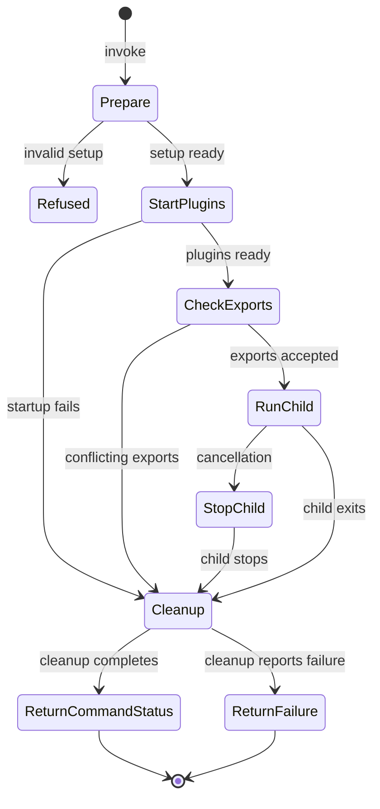

# Run a command with plugins

## Summary

`al run` prepares selected plugins, passes their environment to a child command,
and keeps their resources available until that command stops. Cleanup then runs
before AL returns. A standalone installation can run a child without Bazel
runfiles when no selected plugin needs them.

## The simple case

Run `al run -- /usr/bin/true` for a child without plugins, or use an existing
Bazel-packaged AL command with its configuration and selected plugin labels.
Its command runs after the selected helpers finish starting.
The child reads and writes the operator's ordinary streams. When the child
finishes, AL waits for cleanup and returns to the shell.

The direct form is `al run --config CONFIG --plugin_label KEY=VALUE -- COMMAND
ARGUMENTS`. The `--` separator keeps child options separate from AL options.
Configuration and label flags can be repeated. Plugins are selected explicitly;
supplying a configuration alone does not select all its plugins.

## The interaction, event by event

### Invoke

AL loads the explicit files described by [configuration](configuration.md),
discovers any available runfiles, and opens selected stream overrides. It inherits the
operator's environment. The child is an executable plus arguments, not a shell
expression; shell expansion requires choosing a shell as the child.

An absent runfiles context is allowed. Explicitly configured runfiles must be
valid; an invalid manifest or directory is not silently ignored. A selected
plugin with an absolute executable path needs no runfiles. A selected relative
plugin identifier needs a runfiles context; it is not resolved against PATH.

`--stdin` opens an existing input file. `--stdout` and `--stderr` create missing
output files or truncate existing ones before plugin startup. New files are
created with owner read/write permissions; existing permissions are retained.

### Exits immediately

Help prints usage. A missing command, unreadable configuration, invalid declared
runfiles, unavailable selected plugin executable, inaccessible stream file,
duplicate plugin name, or invalid selected plugin/call prevents the child from
starting. An unselected plugin does not require its executable or runfiles.

### Begins running

A label matches a plugin or call when its key exists and its optional value
matches. A bare key accepts any value. Any matching supplied label selects the
entry; the labels are not an all-must-match filter. Selecting a call also starts
its owning plugin. No supplied labels means no selected plugins or calls.

AL starts the selected plugins and reports their startup on stderr. It combines
their returned environment before launching the child. Equal values for the same
key are accepted once. Different values for the same key refuse child execution;
the diagnostic names the key and plugins in a stable order without printing their
exported values. Selected exports can override inherited environment values.

Startup failure prevents the child, cancels sibling startup, and attempts cleanup
of partial resources. An environment conflict after startup also prevents the
child and proceeds through cleanup of the started plugins.
The [lifecycle reference](../../al/lifecycle.md) owns the detailed guarantees.

### While running

The child uses its assigned streams and can interact with its own services.
Plugin resources stay available while it runs. AL does not make the child a
sandbox or monitor arbitrary descendants. A child needing credentials can use
its inherited access independently of AL's plugin configuration.

Cancellation asks the child to terminate before releasing its resources. The
lifecycle reference owns the grace period and eventual forced stop. Successful
child shutdown does not turn cancellation into a successful invocation.

### Finishes

AL waits for the child, then shuts down plugins and closes stream files it
opened. A child failure is reported and its positive exit status can be
preserved. Cleanup failure also fails the invocation. Child writes are not
rolled back. Forced termination can prevent cleanup entirely.

## Modifiers

| Variant                       | Changes what happens                                                                                                                                             | Changes what is printed                                                                                                          |
| ----------------------------- | ---------------------------------------------------------------------------------------------------------------------------------------------------------------- | -------------------------------------------------------------------------------------------------------------------------------- |
| Arguments and flags           | Configuration and label flags choose helpers; arguments after `--` choose the child and its arguments.                                                           | Child output follows the selected program; AL reports startup and failures on stderr.                                            |
| Environment and configuration | Selected exports override inherited values; conflicting selected exports prevent the child. Runfiles are required only for selected relative plugin identifiers. | Startup and conflict diagnostics identify keys and plugins without their exported values; the child controls its own disclosure. |
| Terminal and streams          | `--stdin` opens an existing file; `--stdout` and `--stderr` create or truncate files instead of inheriting those streams.                                        | Child output replaces the selected files' contents; ordinary inherited streams remain unchanged.                                 |

Flags are fixed before startup. An already running child does not reload a
configuration file when the operator edits it.

## Cancel and interrupt

| Event                          | Before work                                                                                                                 | During work                                                                                             |
| ------------------------------ | --------------------------------------------------------------------------------------------------------------------------- | ------------------------------------------------------------------------------------------------------- |
| Ctrl+C once or twice           | Uses the [invocation signal model](../foundations/invocation.md#interruption); cancellation is checked before child launch. | Requests child shutdown, then plugin cleanup; a second Ctrl+C has no guaranteed escalation.             |
| SIGTERM                        | Cancels setup and prevents a subsequent child launch.                                                                       | Requests child shutdown while plugin resources remain available, then cleanup.                          |
| Terminal closed (SIGHUP)       | No special AL recovery.                                                                                                     | Cleanup is not guaranteed; child/plugin state needs inspection.                                         |
| Input or output pipe closes    | Streams are inherited unless files override them.                                                                           | The child observes EOF or stream failure; AL cleans up when the child exits, without undoing its work.  |
| Network lost                   | Plugin startup can fail; a command without network-dependent setup is unaffected.                                           | Child/plugin behavior determines the failure; cleanup may itself fail when a service is unreachable.    |
| Disk full or file inaccessible | A required configuration, executable, or stream file can prevent startup.                                                   | Child writes or cleanup can fail; earlier files and external changes remain.                            |
| Required state changes         | Required files and plugins are checked as setup reaches them.                                                               | Changes to external files/services are the child's or plugin's concern; AL does not restore a snapshot. |
| Concurrent invocation          | Each invocation prepares its own selected resources.                                                                        | Shared output paths and external resources have no command-wide locking guarantee.                      |
| Forced kill                    | No completed child execution is implied.                                                                                    | Cleanup cannot run; resources and child processes can remain.                                           |

Inspect the child's effects and plugin resources after failure. An invocation
does not produce a general receipt describing those effects.

## Interactions with other systems

**Configuration.** [Configuration loading](configuration.md) happens before
selection. Duplicate plugin names are rejected even if no label selects them.

**Output.** Default streams belong to the operator. AL closes only files it
opened. Output overrides replace previous contents. Opening those files happens
before plugin validation and startup, so a later setup failure can leave an
empty or truncated file even though the child never ran.

**Permissions.** Commands and plugins retain the operator's access. New output
files use mode 0600 subject to the process's permission mask. Existing output-file
permissions are not tightened by stream redirection. Credential
resource permissions and cleanup belong to the [lifecycle reference](../../al/lifecycle.md).

**Concurrency.** Selected plugins start concurrently. Their completion order
does not choose a winner for conflicting exports: different values are refused
before child launch. Shared output paths have no command-wide lock.

**Persistence and recovery.** AL attempts cleanup after ordinary success,
failure, and cancellation. This is not secure erasure or rollback of the child's
work. Recovery depends on the resources and child command selected.

**Network.** AL's selected helpers and the child can contact services. There is
no universal offline mode or retry policy for those operations.

## Edge cases

- Bare `--plugin_label KEY` accepts any configured value for that key.
- Repeating a selector key keeps its last supplied selector value.
- A selected call can start a plugin whose own labels did not match.
- An invalid unselected plugin executable is not started, although duplicate
  plugin names still make configuration invalid for execution.
- Relative plugin identifiers require runfiles even when an executable of the
  same name is available on PATH. Absolute plugin paths work without that context.
- Identical selected exports are accepted, and unselected plugins do not
  participate in export conflict checks.
- Unlike [configuration dump output](configuration.md#finishes), redirection
  retains an existing output file's permissions. Both replace previous contents.

## Open questions and verification

- Sources: [command execution](../../../internal/cli/run.go),
  [selection and exports](../../../pkg/al_plugin/manager.go),
  [plugin startup](../../../pkg/al_plugin/plugin_client.go), and
  [lifetime handling](../../../pkg/lifecycle/lifecycle.go).
- The existing root fixture `tools/al/test/command/command_test.go` covers
  synthetic secret lifetime, startup rollback, and cancellation. This description
  did not perform a new manual plugin or terminal pass.
- `cmd/al/run_e2e_test.go` exercises installed execution, runfiles requirements,
  stream-file replacement, and equal or conflicting plugin exports using copied
  executables and synthetic plugins. The [verification protocol](../verification/README.md)
  distinguishes these later fixtures from the original observations.
- Historical installed-execution and stale-output failures remain in
  [triage](../bug-triage.md); they do not describe the corrected behavior above.
- Stream-file failure and interruption can leave changed contents. Terminal loss,
  repeated signals, and shared-path races still need their dedicated checks.
- Checklist: [command execution](../verification/commands.md#run-a-command-with-plugins).

Verified against alwaldend/src commit `7cd4714139984bf4f9b2ae1de9189470b336e12e`.
