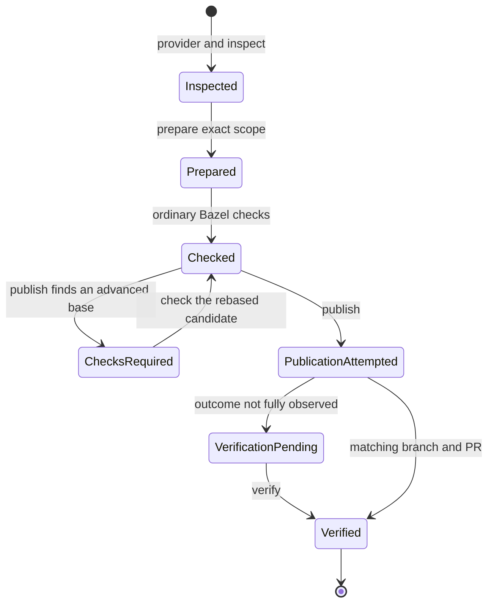
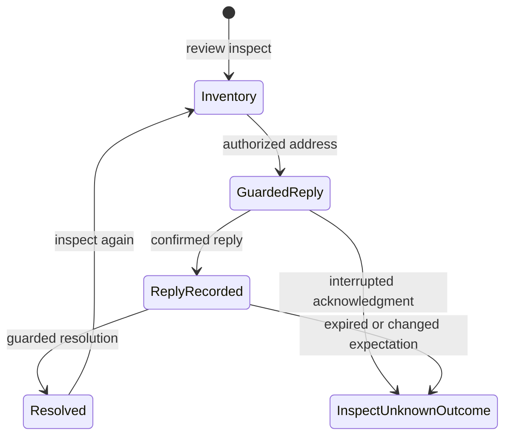

# Prepare, check, publish, and review a branch

## Summary

`al delivery` prepares an explicitly scoped feature change, publishes the exact
branch commit, and maintains its pull request. The operator runs ordinary Bazel
checks between preparation and publication. Receipts bind separate invocations to the candidate and observed remote
state. Review inspection and review mutations are distinct operations; publishing
a branch does not mean that review completed or that the branch was merged.

## The simple case

From the dedicated feature worktree's repository root, run
`al delivery provider`, then `al delivery inspect`. Read the repository identity,
actual PR base, exact heads, changed paths, and refusals. Write the aggregate
message in task scratch and prepare only task-owned paths using repeated `--path`
flags or a deliberately prepared index.

Use `al delivery prepare --message-file MESSAGE --receipt-file RECEIPT ...`
to produce the candidate. Run the normal Bazel checks for the change, inspect
their results, then use `al delivery publish --receipt-file RECEIPT` when
publication is authorized. Receipt-bound `verify` and `review inspect` report
the current publication and review state. The
[delivery reference](../../delivery/README.md#provider-and-delivery-workflow)
owns the complete recipes.

## The interaction, event by event

### Invoke

`provider` reads local remote configuration and reports sanitized forge and
transport capabilities without printing endpoint URLs. Adapter availability
and Git transport support are separate fields. The supported delivery workflow
requires same-repository GitHub topology and SSH fetch and push endpoints.
An HTTPS remote is refused; AL does not rewrite it automatically. Same-repository
ownership remains an operator precondition, not something author names prove.

`inspect` reads forge state and fresh Git refs, including the PR's actual base.
It reports exact candidate and remote identities plus ownership and worktree
conditions. Ancestry and rebase decisions use the selected base. Advancing an
unrelated branch does not make that base stale; advancing the selected base can
require a rebase. Inspection does not itself grant authority to rewrite a branch.

### Exits immediately

Help prints flags. Unsupported provider/transport, unsafe history, mismatched
ownership evidence, stale refs, unsuitable worktree state, or changed PR
expectations can refuse later operations. A refusal states a failed precondition;
it is not a general promise that every earlier step of the workflow was undone.

Preparation is Git-only. It does not run Bazel or publish the branch. The
operator selects separate check commands and explicitly invokes publication.

### Begins running

`prepare` stages the explicit task scope and creates one aggregate candidate.
`--rewrite` binds a one-commit replacement to the exact inspected head;
`--consolidate` explicitly selects an eligible owned multi-commit range. Both
cover the entire existing feature diff, not just newly edited files.
`--message-only` keeps the tree while changing the commit. Preparation writes a
private receipt binding the exact head, tree, scope, and remote expectations.
It does not derive affected targets or prescribe a check format.

The separate `rebase` command fetches current refs and, on an advanced base,
replays the eligible single feature commit locally. It leaves the remote feature
ref and PR unchanged. The report says `rebased`, includes the new local head and
tree, retains the observed remote head and lease, and reports `pushed: false`.
Its `next_action` directs the operator to prepare the new candidate, run ordinary
checks, and publish explicitly. An already-based branch reports `already_based` with
`pushed: false`, including when the remote feature branch does not yet exist.
This direct command does not prepare a replacement candidate receipt; the
operator prepares the result before publication.

### While running

Run ordinary `bazel build` and `bazel test` commands for the prepared candidate.
Bazel owns their arguments, output, cache behavior, and exit status. AL does
not run the checks or store a results ledger. A failed check leaves the candidate
and preparation receipt available for diagnosis. Honor that failure before
publishing; if source is unchanged, retry the ordinary check without another
commit rewrite.

`publish --receipt-file RECEIPT` requires current HEAD and tree to match the
prepared candidate and requires a clean index and unchanged prepared scope. It rechecks the
remote lease and PR expectations. It does not inspect previous check output or
require a caller-supplied validated-head assertion.

If the base advanced, receipt-bound publication can rebase the captured
candidate, update the receipt, and stop with `checks_required` before pushing.
Run the normal Bazel checks against the new candidate, then publish using the
same receipt. Running `prepare` again is unnecessary unless content or message
changes.

Publication pushes the exact feature ref under its lease, updates or creates the
expected PR from the aggregate commit, and verifies the result. Branch push,
PR update, and final verification are distinct side effects. Conflicting PR
metadata is refused rather than silently overwritten.

### Finishes

A verified publication means the captured branch and PR expectations were
observed at verification time. It does not merge the PR, deploy artifacts, or
prove future review outcomes. The [state foundation](../foundations/state.md)
owns these completion boundaries.

If publication succeeded but its final read failed,
`publication_verification_pending` retains the known candidate and PR with
`verified: false`. Use `verify --receipt-file RECEIPT` to inspect that
postcondition before choosing recovery. A failed invocation can follow a
successful push or PR mutation; it does not establish that remote state is
unchanged. A guarded publication retry can finish an exact prior or desired PR
projection when the feature ref already equals the prepared candidate.

Checked represents the operator's successful checks; it is not an AL receipt
status or a stored validation gate.

### Review is a separate interaction

`review inspect` returns a bounded inventory of reviews, threads, comments, and
requests. It is an observation, not a review-execution monitor or a completion
signal. A newly published head does not inherit an older head's review verdict.

For an authorized response, `review address` requires a clean exact prepared
candidate and verifies its remote publication. It posts the reasoned reply,
retains its attempt evidence, and resolves the selected thread. It does not fix
the code, run checks, or read validation logs. Low-level `comment`,
`reply`, `resolve`, and `request` operations remain available, each requiring the
fresh exact provider expectations described in the
[review reference](../../delivery/README.md#review-workflow).

Replies and resolutions use bounded, short-lived receipt authority. Unknown
outcomes do not invite blind reposting; inspect remote state. Only an explicit
read-failure restoration permits reuse of the unchanged unexpired authority.
These guards do not make the forge's writes atomic with another person's edits;
an actively coedited PR is not a safe mutation target.

## Modifiers

| Variant                       | Changes what happens                                                                                                                                     | Changes what is printed                                                                                            |
| ----------------------------- | -------------------------------------------------------------------------------------------------------------------------------------------------------- | ------------------------------------------------------------------------------------------------------------------ |
| Arguments and flags           | Repository, remote, base, executable, explicit path/index scope, rewrite choice, receipt, and publication flags select the operation and its boundaries. | Structured JSON identifies the captured refs, candidate, refusals, and publication state.                          |
| Environment and configuration | Forge credentials and Git signing must be available. AL credential plugins do not start; ordinary Bazel checks use their own configuration.              | The provider report omits endpoint URLs; ordinary Bazel commands own their check output.                           |
| Terminal and streams          | Delivery uses structured subprocess calls; it does not present a general interactive confirmation flow.                                                  | Reports use stdout and errors use stderr; retaining stdout is necessary to preserve returned candidate identities. |

Flags are fixed at invocation. Editing a receipt or captured input during work
can invalidate its exact-state guards.

## Cancel and interrupt

| Event                          | Before work                                                                    | During work                                                                                                                      |
| ------------------------------ | ------------------------------------------------------------------------------ | -------------------------------------------------------------------------------------------------------------------------------- |
| Ctrl+C once or twice           | Uses the [invocation signal model](../foundations/invocation.md#interruption). | Active subprocess work is cancelled; retain candidate and receipt evidence because earlier mutations may remain.                 |
| SIGTERM                        | Requests cancellation.                                                         | No complete-workflow rollback; inspect local and remote postconditions.                                                          |
| Terminal closed (SIGHUP)       | No special AL recovery.                                                        | Output can disappear before the outcome is observed; inspect existing receipt state.                                             |
| Input or output pipe closes    | No stdin confirmation is required for publication.                             | A report-write failure can follow a successful commit, push, or PR mutation.                                                     |
| Network lost                   | Provider detection remains local; inspection or publication reads can fail.    | Push or forge outcome may be unknown; verify the remote postcondition before retrying.                                           |
| Disk full or file inaccessible | Required message and receipt paths must be usable.                             | Candidate or receipt writing can fail; a command error does not remove already created commits.                                  |
| Required state changes         | Exact snapshots determine the candidate and expectations.                      | Candidate, index, prepared scope, refs, and PR metadata are rechecked; a changed base can require checks on a rebased candidate. |
| Concurrent invocation          | Operations sharing a receipt contend for its lock.                             | Cooperating receipt writers serialize; remote leases guard the feature ref, but forge writes are not atomic with human edits.    |
| Forced kill                    | No completion is implied.                                                      | Cleanup or evidence finalization may not run; inspect before recovery and do not erase attempt records to force a retry.         |

## Interactions with other systems

**Configuration.** Repository and tool selectors are explicit. The supported
GitHub adapter uses Git over SSH and the forge CLI for API operations. Provider
recognition is broader than supported delivery adapters.

**Output.** JSON reports and private local evidence serve different purposes.
Keep exact candidate identities and PR URLs from the report; a zero-exit
inspection does not certify that publication is safe or required.

**Permissions.** The operator chooses ownership and authorization. A receipt is
consistency evidence, not a permission grant. The command can create local
commits, replace an owned remote feature ref, and mutate PR state within the
explicitly chosen workflow.

**Concurrency.** Receipt locks cover cooperating AL operations; exact ref leases
detect remote progress. The forge still permits a concurrent edit between a
check and a mutation, so actively coedited metadata requires coordination.

**Persistence and recovery.** Preserve receipts and check evidence under ignored
task scratch. The operator decides which checks cover a changed candidate. Resolve
uncertain attempts by observation before any diagnosed manual recovery.

**Network.** Provider detection is local. Fresh inspection, publication,
verification, and review operations contact Git or the forge. Separate Bazel
checks can contact their configured build services. Direct rebase fetches
remote observations even though its branch update is local.

## Edge cases

- A message-only amendment changes the candidate OID even when its tree is
  identical; commit-sensitive checks may still change.
- A single generated path removed by the new base is not automatically lost
  work: a rebase permits that reduction only when the prior candidate and base
  tree entries are identical. Other scope changes are refused.
- Publication and receipt-bound verification require the exact candidate, clean
  index, and unchanged prepared scope. Unrelated unstaged and untracked files
  are preserved without a rebase; rebasing requires a fully clean checkout.
  Review addressing also requires a fully clean prepared checkout.
- A base-ref race can be detected after a feature push; the feature ref can be
  briefly visible before a guarded rollback attempt. Cross-ref atomicity is not
  provided by the forge.
- `--no-pull-request` is an explicit option for publication without an existing
  PR; it does not silently remove an existing PR from the workflow.
- Review reply evidence prevents blind duplicate replies, but it cannot prove
  that every possible concurrent human moderation event was observed.

## Open questions and verification

- Source: `internal/delivery/command.go`, `delivery.go`, `rebase.go`,
  `review.go`, `review_address.go`, and the linked command
  reference.
- Behavior fixtures: `delivery_integration_test.go`,
  `review_address_test.go`, and `receipt_test.go` in `internal/delivery`.
- The isolated rebase fixtures check an advanced base with both an absent and an
  existing remote feature ref, an already-based branch, and dirty-worktree
  refusal. Their automated pass is recorded separately from historical rebase
  observations in the [verification protocol](../verification/README.md).
- Terminal loss, forced termination during remote writes, and provider races
  require isolated failure fixtures; no live review comments were posted for
  this description.
- Checklist: [delivery](../verification/delivery.md#delivery-workflow).

Verified against alwaldend/src commit `7cd4714139984bf4f9b2ae1de9189470b336e12e`.
