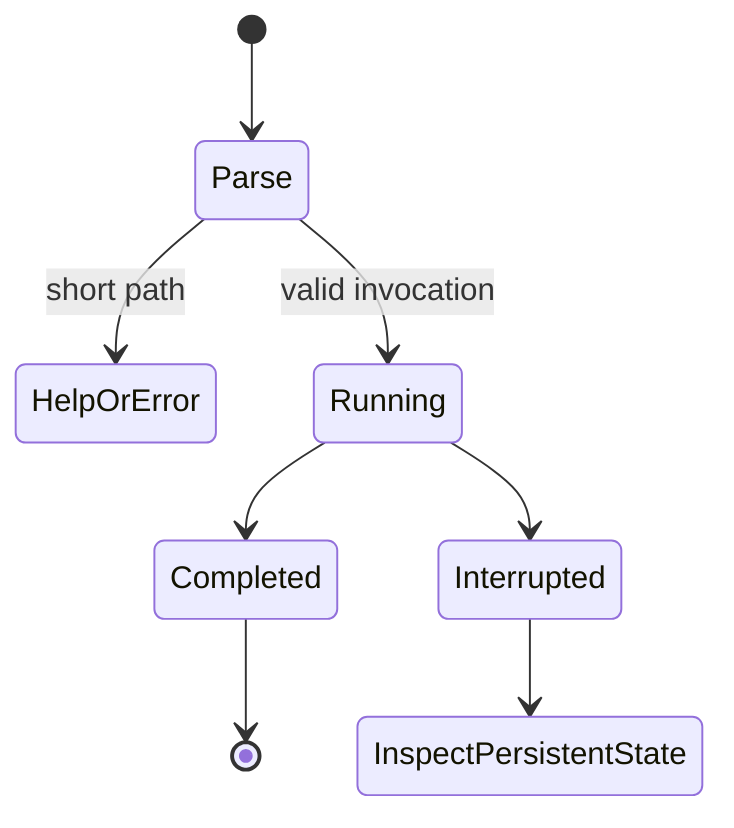

# Invocation, streams, and interruption

## Summary

AL exposes `config`, `run`, `version`, `release`, `delivery`, `bazel`, and `doctor`
directly. There is no intervening `repo` command. Help is available through
`al --help`, `al COMMAND --help`, and `al help COMMAND`.

## Entry and output

Each invocation selects a command before any selected credential plugins start.
Only `run` starts configured plugins. An ordinary invocation succeeds with exit
status zero; execution errors normally produce a nonzero status and a diagnostic
on stderr. A child exit status can be preserved. Ordinary builds and tests invoke
Bazel directly; `al bazel test` selects tests from Git changes before running
Bazel. AL does not define a universal `--json`,
`--quiet`, or `--dry-run` option: use each leaf's help.

`config dump`, `doctor`, release `plan`/`inspect`, website-operation dry runs, and
delivery reports produce JSON where documented.
`version show` produces text by default and accepts `--format json`. Release
commands primarily create files or perform one selected mutation. The nested
`release website` commands own extraction and activation. Success does not
require a JSON report. AL has no interactive command shell, background scheduler,
or automatic binary update step.

Relative path interpretation is command-specific. Version and delivery accept a
repository selector; doctor defaults to the current directory. Bazel-run tools
can start in a runfiles tree. Pass absolute paths for caller-owned files unless
the relevant command reference explicitly guarantees a different interpretation.

An installed `run` invocation does not always need Bazel runfiles. Its selected
plugin executables determine that requirement; invalid explicitly supplied
runfiles still fail. [Command execution](../commands/run.md#invoke) owns the
path and stream-file rules.

## Interruption

AL requests cooperative cancellation on SIGINT and SIGTERM. There is no universal
second-Ctrl+C escalation: a second signal must not be described as a guaranteed
force kill. SIGHUP and SIGKILL have no AL cleanup handler. A cancelled or failed
invocation is not evidence that earlier writes were rolled back.

Version commands cancel their active Git process group. Bazel controls build
cancellation when invoked directly. Foreground Git can use the terminal
for authentication and AL restores terminal ownership. `al run` has a different
child and cleanup policy, owned by the
[command lifecycle reference](../../al/lifecycle.md). Local release-generation
file copies do not uniformly check cancellation. Each feature's table narrows
these guarantees instead of assuming all work responds identically.

Pipe closure is not a request for transactional rollback. A subprocess can stop
or output writing can fail after a durable operation. Check persistent state and
receipts before choosing a recovery action.

## Common boundaries

Configuration flags are local to their command family. Ordinary lifecycle
commands do not automatically consume `al run` plugin configuration. Child
programs remain trusted programs with the operator's access; AL is not a sandbox.
No command's help text grants authority to deploy or overwrite external state.

## Open questions and verification

- Source: `cmd/al/main.go`, `internal/cli/root.go`, `internal/cli/run.go`,
  `internal/versioning/git.go`, and `internal/bazelcmd/main.go`.
- SIGHUP, broken pipes, and repeated signals need per-command terminal checks;
  no universal output timing, color, or rollback claim is made.
- Checklist: [invocation](../verification/foundations.md#invocation).

Verified against alwaldend/src commit `7cd4714139984bf4f9b2ae1de9189470b336e12e`.
