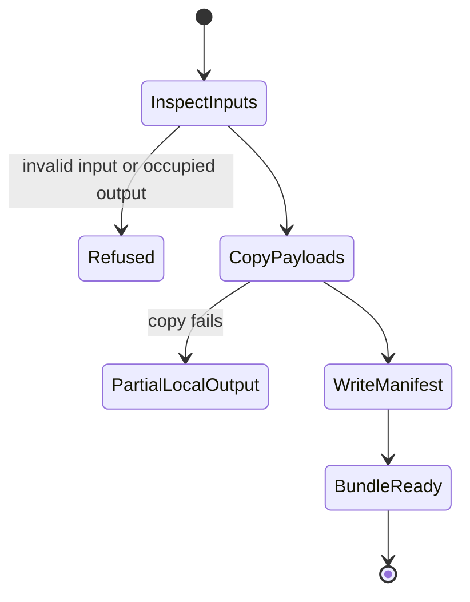

# Generate a project bundle

## Summary

`al release generate` assembles declared payloads and release metadata into a
local bundle. Generation makes files inspectable; it does not publish anything.

## The simple case

Create a workspace-status file and one payload, then run
`al release generate --project projects/example --version_file STATUS
--add_file PAYLOAD --output_dir EMPTY_DIRECTORY`. Inspect `release.json` and
`files/` in the output. The payload retains its basename. For ordinary project
builds, use the owning `releases:bundle` target and
[version stamping](versioning.md), as described by the
[module's build recipe](../../../README.md#build-one-project).

## The interaction, event by event

### Invoke

The operator chooses a project, status file, and payloads. Repeat `--add_file`
for several files. AL reads files to record sizes and SHA-256 digests. Optional
input manifests and deployment metadata are merged before outputs are written.
The source identity is the version, channel, commit, and tree state supplied by
the build; optional GitBundle history can provide release-page changelogs.

### Exits immediately

Help writes command usage. Missing inputs, invalid status values, unsafe names,
colliding basenames, and bundles without payloads fail. A nonempty output
directory is refused; generation is not an overwrite operation.

### Begins running

For a bundle, AL creates the destination's `files` directory after checking the
identity and available inputs. Nondevelopment first-party bundles require clean
source identity. Development bundles can be inspected but cannot be published.

### While running

AL copies payloads into the output. Source symlinks can resolve to regular
payload files. A copying failure can leave a partial local output directory;
the absence of a completed manifest distinguishes it from a completed bundle.
Do not reuse that nonempty directory as the next generation destination.

### Finishes

The bundle manifest is written after payload copies finish. Optional
`--output_manifest` and `--output_release_page` also write explicit outputs.
A successful invocation leaves local files; no destination has been contacted.

## Modifiers

| Variant                       | Changes what happens                                                                                                                  | Changes what is printed                                                  |
| ----------------------------- | ------------------------------------------------------------------------------------------------------------------------------------- | ------------------------------------------------------------------------ |
| Arguments and flags           | Payload, project, status, merge and output flags choose the local artifacts; `--output_file_mode` controls manifest/page permissions. | `--indent` controls JSON layout; help lists all output options.          |
| Environment and configuration | Explicit build inputs supply release metadata; AL plugin configuration is not loaded.                                                 | No plugin startup output.                                                |
| Terminal and streams          | Files are written to explicit paths; a terminal is not required.                                                                      | Generated artifacts are files; errors use the command diagnostic stream. |

These selections are fixed at invocation; changing a source file during the copy
is not a supported way to change a bundle.

## Cancel and interrupt

| Event                          | Before work                                                                    | During work                                                              |
| ------------------------------ | ------------------------------------------------------------------------------ | ------------------------------------------------------------------------ |
| Ctrl+C once or twice           | Uses the [invocation signal model](../foundations/invocation.md#interruption). | File copying does not promise prompt cancellation; inspect local output. |
| SIGTERM                        | Uses the invocation signal model.                                              | No transaction-wide rollback of local outputs is promised.               |
| Terminal closed (SIGHUP)       | No special AL recovery.                                                        | Files already written can remain.                                        |
| Input or output pipe closes    | Payloads come from named files, not stdin.                                     | Diagnostic stream closure has no rollback guarantee.                     |
| Network lost                   | No effect for ordinary local inputs.                                           | No effect for ordinary local inputs.                                     |
| Disk full or file inaccessible | Reading required inputs fails.                                                 | Copy or manifest writing fails; partial local files can remain.          |
| Required state changes         | Current inputs are read.                                                       | Concurrent input edits have no snapshot guarantee; use stable inputs.    |
| Concurrent invocation          | Each must use its own empty output.                                            | A shared output has no whole-bundle locking contract.                    |
| Forced kill                    | No completed output is implied.                                                | Partial files remain; generate into a fresh directory.                   |

## Interactions with other systems

**Configuration.** Release flags and status metadata are explicit; no credential
plugins start.

**Output.** The [state model](../foundations/state.md) distinguishes the local
manifest from the canonical public manifest.

**Permissions.** Inputs must be readable and output writable. Payload copies use
ordinary file permissions; the manifest/page mode is a separate option.

**Concurrency.** Use stable inputs and one output directory per invocation.

**Persistence and recovery.** Inspect local output after failure and choose a
fresh empty output for retry. Generation has no artifact-operation receipt.

**Network.** Generation does not contact an SSH or OCI destination.

## Edge cases

- Two payloads with the same basename cannot share one bundle.
- Every bundled manifest item needs a corresponding local `--add_file` source.
- Third-party version ownership differs from first-party source stamping.
- An already generated bundle is not evidence of remote publication.

## Open questions and verification

- Source: `internal/release/generator.go`, `bundle.go`, `cmd.go`, and
  `bundle_test.go`; built-CLI fixture: `cmd/al/lifecycle_e2e_test.go`.
- File-copy interruption latency and shared-output races need explicit runtime
  observations; no prompt-stop guarantee is inferred from signal registration.
- Checklist: [bundle generation](../verification/releases.md#generate-a-project-bundle).

Verified against alwaldend/src commit `7cd4714139984bf4f9b2ae1de9189470b336e12e`.
