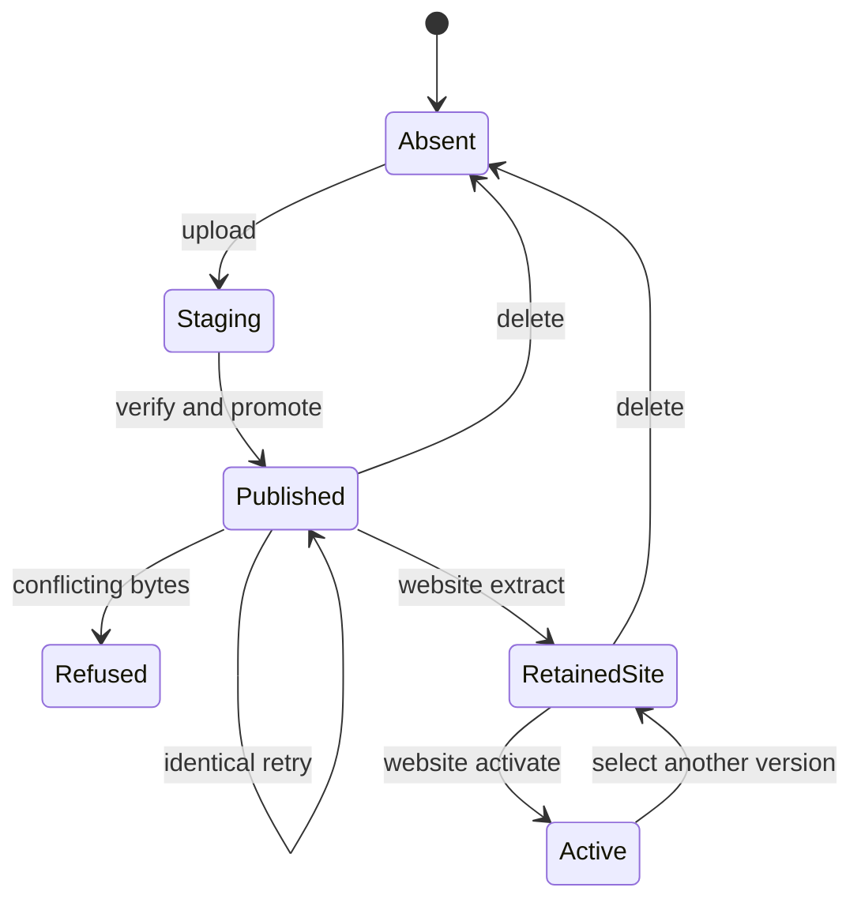
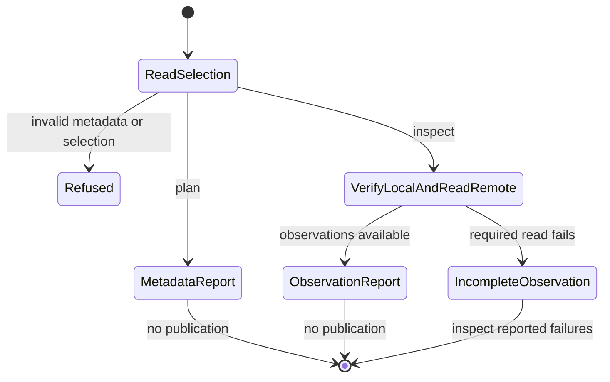

# Artifact publication and website operations

## Summary

`al release plan` previews the selected publication from local metadata.
`al release inspect` checks local payloads and observes the selected destination.
`al release publish` uploads selected project artifacts to that SSH destination.
`al release website extract` creates a retained site from a published archive;
`al release website activate` selects a retained site. These are separate
commands. `al release delete` removes an inactive release. Existing publications
are immutable until that explicit deletion.

## The simple case

Build one project's bundle using a shared source version. Select its bundle with
`--release_dir`, the environment with `--environment`, and an explicit SSH host
or deployment file. Run `plan` with those selections to inspect the identity,
destination, steps, and declared payloads without contacting the destination.
Use `inspect` when current local-file and remote-state observations are needed.
Then run `publish` explicitly to upload artifacts. For a website, separately
run `website extract` and `website activate` with the same bundle and destination.
Each website command supports an offline preview through `--dry-run`. Read the
completed-operation output and optional `--receipt` file. Other projects
need not be built or published. The [operator recipe](../../../README.md#publish-over-ssh)
provides complete destination flags and prerequisites.

## The interaction, event by event

### Invoke

AL reads each selected bundle's manifest. An explicit `--ssh_host` or
`--ssh_deployment` selects all manifest items; otherwise the environment selects
matching SSH deployment items. An empty selection fails. A development identity
cannot be published. Third-party artifacts have their own namespace and support
upload and explicit deletion, but not website extraction or activation.

The command selects one operation: `publish` uploads, `website extract`
extracts, `website activate` activates, and `delete` deletes. There is no generic
step-selection flag. Extraction accepts `--site_archive` to select a declared
archive. Activation selects an already retained site without reading a local
archive. Each operation runs independently.

### Exits immediately

Help makes no release changes. Invalid destinations, unsafe identities, and
unsupported selections fail before their operation. OCI metadata can be generated,
but OCI publication is disabled because its old mutable-tag path cannot provide
the publication guarantee. This refusal does not fall back to SSH automatically.

`plan` and `inspect` are observations, not implicit requests to publish. A plan
does not validate local payload bytes, authenticate to SSH, or establish that the
selected destination will accept the operation. Inspection can observe changed
state without authorizing its replacement. Neither report is an operation receipt.

If `--receipt` is requested for a mutation, AL must initialize its private local
file before remote work. Website `--dry-run` writes an offline plan without
performing that operation; combining it with `--receipt`, even an explicitly
empty value, fails before effects. A later bundle or destination can fail after
earlier ones completed; the invocation is not an atomic transaction across all
selections.

### Begins running

For artifact upload, AL checks an existing public identity under the destination lock. If the canonical
manifest, complete file set, sizes, and digests match, upload succeeds without
opening local payloads or transferring them again. A mismatch refuses overwrite.

For a new identity, AL verifies and copies local files to staging, transfers the
complete set to destination staging, then verifies it there. Publication exposes
the complete directory in one promotion. A failed transfer does not expose a
partial new public release.

### While running

The selected operation begins only after its receipt checkpoint, if requested. The
[state foundation](../foundations/state.md#receipts) owns pending, unknown, and
completed meanings. AL prints `Completed STEP for PROJECT/VERSION in ENVIRONMENT`
after confirming each step. A subsequent failure preserves prior completed steps.

`website extract` fetches the declared published archive, verifies it, and
extracts it locally before promoting a retained site. A root `index.html` is required.
[Archive types, entry limits, and rejected members](../../../README.md#extract-and-activate-a-website)
are part of the operator contract. The local disk must hold the archive and
extracted content. Uploading an archive alone never extracts it.

`website activate` verifies the retained site's binding and published payloads,
then selects it through `sites/PROJECT/current`. Earlier retained sites remain
available. Rollback is an explicit `website activate` for another retained
version. A failed extraction leaves activation unchanged.

Deletion first checks both release and site paths, managed ancestry, mounts,
and active-site status before removing either tree. An active website must be
replaced by another retained selection first. Deletion is guarded, but its two
removals are not a crash-atomic pair: an interruption can leave only one removed.

### Finishes

A successful upload means downloadable files exist at the selected identity.
Successful extraction means a retained site exists; successful activation means
it is selected. Successful deletion means the selected release and retained site are
absent. Deleting an already absent release succeeds. Shared Git tags remain.

After deletion, ordinary publication can reuse the identity with different bytes.
There is no tombstone, restoration command, or requirement to reproduce the old
contents. Publication receipts are evidence of an attempt, not locks on future
state. After an unknown outcome, run `inspect` with the same bundle and destination
selection. Compare its publication digest and observed state with the receipt,
then retry only the intended unresolved step. Inspection does not update the
receipt or reserve the observed state for that retry.

### Preview and inspection are separate interactions

`plan` reads the selected manifests and destination configuration, applies the
publication selection rules, and returns a JSON description of what was selected.
Its metadata-only result names the project identity, upload operation, destination,
declared payloads, and canonical publication digest. It distinguishes selection
through an explicit host/deployment from selection through environment metadata.
When SSH configuration owns the port, the report leaves it unspecified instead
of inventing a resolved connection setting.

The plan uses schema `release/artifact_plan/v1` and mode `offline_metadata`.
Each entry in `operations` includes `selection` (`explicit` or `environment`),
the namespace/project/version, source identity when applicable, requested steps,
payload names/sizes/digests, publication digest, and public/site paths. Its
destination describes environment, host or SSH alias, root, and account selectors.
Its `port` and `ssh_user` are `null` when OpenSSH configuration owns their
resolution. A `null` `publish_user` means commands use the SSH login account
directly. The report omits credential material and identity/trust-file paths.

Website `extract --dry-run` and `activate --dry-run` produce the same plan schema
for their fixed operation. Their report retains backend operation names `extract`
and `link`; the artifact plan uses `upload`. This is a preview, not an inspection
of archive bytes, site validity, or the current link. Each website dry run rejects
`--receipt` before remote work.

Planning does not open payload files, start SSH or rsync, initialize an operation
receipt, or create destination state. A valid plan can therefore name missing
local payloads or an unavailable destination. Run the selected publication command
separately; it rereads inputs and performs its own checks. This publication plan
is distinct from a [source-ref publication plan](versioning.md). Both release observation
commands reject `--receipt`; it belongs to mutating operations.

`inspect` uses the same bundle and destination selection, verifies local payloads,
and reads the remote publication and retained-site state. Local and remote
observations are independent: a matching remote publication can coexist with
missing local files, which matters for an identical upload retry. Inspection
does not create staging, acquire a mutation lock, repair a publication, extract
a site, or change the current selection.

Activation is reported independently from retained-site validity. A selected site
does not become valid merely because the current link points to it. When a read
fails, its state remains unavailable or unknown rather than being reported absent.
Inspection does not load an earlier receipt; the canonical publication digest
helps the operator compare an observation with the identity recorded in one.

Inspection uses schema `release/artifact_inspection/v1` and mode
`read_only_snapshot`, adding `observed_at` when its reads finish. The timestamp
does not make its multiple reads atomic. Each operation adds these observations:

| Field                 | Reported states and meaning                                                                                                                                                                                                                 |
| --------------------- | ------------------------------------------------------------------------------------------------------------------------------------------------------------------------------------------------------------------------------------------- |
| `local`               | Each payload is `verified`, `missing`, `corrupt`, or `unreadable`. These findings do not suppress the remote read.                                                                                                                          |
| `remote.status`       | `absent`, `matching`, `conflicting`, `corrupt`, or `unavailable`. Matching requires the expected canonical manifest and complete regular file set with the expected sizes and hashes.                                                       |
| `remote.site.status`  | `absent`, `retained`, `active`, `conflicting`, `corrupt`, `not_applicable`, or `unavailable`. Site validation checks the binding, guarded ancestry, and regular root `index.html`; it does not rehash every extracted site file.            |
| `remote.site.active`  | `true` when the current link selects this version, independently of site validity; `false` for a known unselected version; `null` when selection is unavailable, inapplicable, or unsafe. A selected dangling link can still report `true`. |
| `remote.site.current` | `absent`, `selected`, `other`, `dangling`, `unsafe`, `not_applicable`, or `unavailable`. This distinguishes the current link's condition from the selected site's validity.                                                                 |

A completed inspection can exit zero while reporting missing, unreadable,
conflicting, or corrupt content. Zero means the observations completed, not that
publication or activation is ready. With valid metadata selections, a failed SSH
read, invalid response, timeout, or excessive response leaves remote fields
unavailable, emits the JSON report, and returns a nonzero status with a diagnostic.
These failures do not report the release absent.
Cancellation during local payload verification stops that work before the remote
read and can return before a JSON report is written. It is an interrupted
inspection, not a finding that the payload is corrupt.

## Modifiers

| Variant                       | Changes what happens                                                                                                                                                                                                                        | Changes what is printed                                                                                                             |
| ----------------------------- | ------------------------------------------------------------------------------------------------------------------------------------------------------------------------------------------------------------------------------------------- | ----------------------------------------------------------------------------------------------------------------------------------- |
| Arguments and flags           | The command selects upload, extraction, activation, or deletion. Destination, project/namespace, timeout, and SSH flags select its target; extraction also accepts an archive. `plan`, `inspect`, and website `--dry-run` do not mutate it. | Observations and website dry runs return JSON. Mutations print confirmed-step lines and optionally checkpoint `--receipt` evidence. |
| Environment and configuration | `--environment` selects a destination group. Normal SSH configuration supplies trust and authentication for inspection and publication; planning uses only declared settings.                                                               | Unresolved SSH settings remain unspecified in the plan; no credential values belong in manifests or receipts.                       |
| Terminal and streams          | Planning needs no connection or terminal input. Inspection and publication use noninteractive SSH with strict host-key checks.                                                                                                              | Reports use stdout; a closed output stream can prevent receipt of a complete observation or completion line.                        |

Flags are fixed for the attempt. A changed destination file or bundle requires a
new invocation; do not edit inputs during publication.

## Cancel and interrupt

For `plan`, `inspect`, and website `--dry-run`, interruption can prevent a complete report but does not
turn the observation into a publication or recovery action. The remote changes,
staging, and receipt checkpoints described below apply to mutating commands.
An interrupted inspection must be rerun to obtain fresh observations.

| Event                          | Before work                                                                | During work                                                                                        |
| ------------------------------ | -------------------------------------------------------------------------- | -------------------------------------------------------------------------------------------------- |
| Ctrl+C once or twice           | Uses [invocation cancellation](../foundations/invocation.md#interruption). | Active work is cancelled where observed; completed steps remain and a started step may be unknown. |
| SIGTERM                        | Requests cancellation.                                                     | Same recovery boundary as Ctrl+C; no complete-workflow rollback.                                   |
| Terminal closed (SIGHUP)       | No special recovery.                                                       | Remote work may have occurred; inspect receipt and destination.                                    |
| Input or output pipe closes    | Commands do not ask for a confirmation on stdin.                           | Loss of completion output does not prove failure of remote work.                                   |
| Network lost                   | Connection or trust checks fail.                                           | Staging can remain; after a lost acknowledgment the public outcome can be unknown.                 |
| Disk full or file inaccessible | Unwritable requested receipt prevents remote work.                         | Staging, extraction, or checkpoint can fail; preserve earlier completed steps.                     |
| Required state changes         | Inputs determine the attempted identity.                                   | Destination contents and bindings are rechecked under lock; conflicting contents fail.             |
| Concurrent invocation          | Both can inspect the same destination.                                     | Final locked verification preserves an existing identity; identical contenders can succeed.        |
| Forced kill                    | No completed step is implied.                                              | Cleanup may not run; a receipt may remain running with an unknown step.                            |

## Interactions with other systems

**Configuration.** Destination selection uses explicit release options and
manifest deployment metadata, not `al run` credential plugins.

**Output.** Completion lines describe individual steps. The canonical public
manifest omits transport configuration; the local receipt includes the resolved
destination and publication digest. Planning and inspection return JSON reports
whose observations do not become checkpoints for a later invocation. Website
dry runs use that same plan format; receipt/completion names retain the backend
`extract` and `link` operation names.

**Permissions.** The operator needs SSH access and the configured content-account
rights. The [operator reference](../../../README.md#publish-over-ssh) owns tool,
mode, and timeout defaults. AL does not provision the receiver.

**Concurrency.** The destination lock protects cooperating project operations.
External changes are not authorized by that lock and must still satisfy checks.

**Persistence and recovery.** Whole-attempt atomicity is not promised. Preserve
receipts and inspect the selected destination after an unknown outcome. Compare
the selected digest and observed state before retrying the intended unresolved
step. Never infer that a failed invocation deleted or restored earlier work. A plan is a preview;
inspection reports what its reads observed and does not reserve that state.

**Network.** OpenSSH and rsync contact the selected destination. The separate
infrastructure mirror is outside this command and can replace public state under
its own operator workflow. Planning is offline. Inspection uses SSH reads and
does not transfer a new publication through rsync.

## Edge cases

- An identical upload can succeed even when the local payload files are missing.
- An extra remote file or a corrupt byte causes retry verification to fail.
- Symlinked ancestry and nested mounts, including bind-mounted files, block
  deletion. Mounts inside a selected retained site also block activation.
- A retained site's binding must match the selected publication; sharing a version
  string is insufficient.
- A plan can succeed without readable payloads or usable SSH credentials; it
  verifies metadata selection only. Inspection can report remote content even
  when those local payloads are missing or corrupt.
- An inspection's active selection is not proof that the site is valid or
  serving successfully. Use its site and current-link findings together.
- A current-link target containing a control character, including an added
  newline, is unsafe. Its near-match to a version name does not establish selection.
- Multiple release directories and destination groups can leave partial overall
  progress even though each publication has its own guarded boundary.

## Open questions and verification

- Source: `internal/release/cmd.go`, `deployer.go`, `observation.go`,
  `ssh_deployer.go`, `ssh_config.go`, `receipt.go`, and `lifecycle_test.go`.
- Planning and inspection fixtures in `observation_test.go` exercise the built
  CLI with controlled SSH transport and compare destination contents before and
  after each observation. The final fixture record also covers cancellation
  during local hashing before SSH starts. These automated observations are
  recorded as O1 in the [verification protocol](../verification/README.md#later-fixture-passes).
  Site inspection deliberately does not verify every extracted file; readers
  must not interpret it as a full website integrity scan.
- Lost acknowledgments, forced termination during deletion, and external writers
  require destination-state observations. They are not covered by local help checks.
- Checklist: [publication](../verification/releases.md#publication).

Verified against alwaldend/src commit `7cd4714139984bf4f9b2ae1de9189470b336e12e`.
