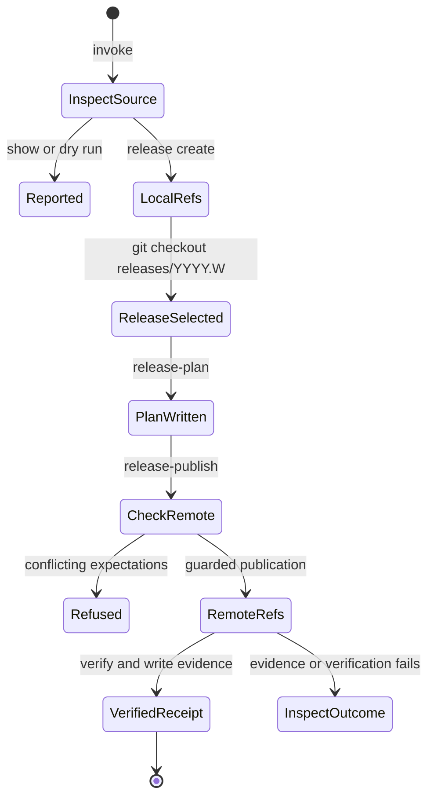

# Inspect versions and publish source refs

## Summary

`al release create` creates a weekly source branch and its initial tag.
`al version` calculates the shared source version, prepares nightly and patch
tags, publishes reviewed source refs, and supplies version metadata to builds.
These operations do not select projects or publish their artifacts. The
[calendar scheme](../../../README.md#prepare-source) owns the development,
nightly, weekly-branch, and patch naming rules.

## The simple case

Run `al version show --format json` to inspect the current checkout's version,
channel, commit, branch, and tree state. For an authorized weekly release, start
from clean trunk and run `al release create`. AL creates the weekly branch and
its initial tag atomically, leaving HEAD and the checkout on trunk. Run
`git checkout releases/YYYY.W` with the branch name that `create` printed to
select the release before building or tagging it. AL provides no checkout command.

Write a source-ref plan with `al version release-plan --lease weekly-release
--plan PLAN`, inspect the exact refs and commit, then use
`al version release-publish --plan PLAN --receipt RECEIPT`. A successful receipt
reports verified remote source refs. Build and publish each desired project
separately through [bundle generation](bundle.md) and
[artifact publication](publication.md).

## The interaction, event by event

### Invoke

The selected repository defaults to the Bazel workspace environment when
present, otherwise the current directory. `--repository` chooses a checkout.
Version-command shared flags work before or after the leaf command.
`al release create` has its own repository, trunk, date, and dry-run flags.

`show` reads source state without creating refs. `--channel` disambiguates
release and nightly inspection; `--release` supplies a release-line context for
a detached checkout or its matching release branch. These selectors do not
retag the source. Ref-changing commands reject them rather than interpreting
them as permission to change the selected version.

### Exits immediately

Help prints the relevant flags. Invalid channels, calendar values, missing
required plan paths, or unsupported output formats fail. Local ref preparation
requires a clean eligible branch with no Git operation in progress. Dry runs
check the same ref eligibility and namespace collisions without creating refs.
Creation never changes the selected branch; choosing another checkout is a
separate Git operation.

An ordinary untagged development checkout can be inspected while dirty, but
nondevelopment stamping refuses a dirty checkout. A source-ref plan cannot
publish a development version.

### Begins running

`version nightly-tag` creates a local nightly tag on clean trunk. `release create`
creates the weekly branch and initial tag together without switching HEAD.
`version release-tag` creates the
current patch tag on a clean weekly branch. Existing local refs are not
silently overwritten. A second nightly on the same unchanged commit is refused,
even when its date would produce a different tag name.

`release-plan` writes and prints the reviewed JSON plan. This is a local file
operation; it does not publish refs. `release-publish` reads that exact plan,
checks the selected remote, and acquires the shared source-ref operation lock.
Its `--atomic` setting must match the plan. Atomic publication needs an explicit
lease value; a remote that cannot provide the requested atomic update causes a
refusal rather than an automatic non-atomic fallback.

### While running

Source publication checks remote ref expectations again under the local lock.
Absent create refs may be created; existing refs are acceptable only at the
expected commit. A conflicting tag or branch fails. A patch plan verifies the
already delivered weekly branch independently of a diverged trunk.

`bazel-status` prints workspace-status metadata without launching a build.
In this repository, `bazel build --config=release TARGET` invokes the installed
AL status command for the current workspace. Install or update AL before the
build; the status command does not bootstrap another Bazel process. The
[build reference](../../../README.md#build-one-project) owns setup and explicit
version selection. Bazel controls build output, status, and cancellation.

### Finishes

Local ref preparation prints the created tag or branch. Source publication
rechecks the remote refs and prints its receipt, also writing it when
`--receipt` is selected. Building with stamping produces build outputs; neither
that build nor source-ref publication uploads a project's bundle.

Completion of the remote operation can precede local evidence writing. If
writing the receipt or stdout fails, the refs can already exist remotely.
Inspect those refs before recovering. Release creation and checkout are separate:
if the later `git checkout` fails, the branch and tag created by AL still exist.

## Modifiers

| Variant                       | Changes what happens                                                                                                                                                                      | Changes what is printed                                                                                               |
| ----------------------------- | ----------------------------------------------------------------------------------------------------------------------------------------------------------------------------------------- | --------------------------------------------------------------------------------------------------------------------- |
| Arguments and flags           | Repository, trunk, inspection channel, release context, date, dry run, plan, remote, and atomic options select their documented operation.                                                | `show --format json` adds structured state; local preparation prints a ref; plan and publication commands print JSON. |
| Environment and configuration | The default repository can come from the Bazel workspace environment; Git identity, transport, signing, and trust use the selected operation's Git setup. No AL credential plugins start. | Git diagnostics can accompany failures; stamping emits its defined status keys.                                       |
| Terminal and streams          | Foreground Git authentication can use the controlling terminal; piped execution has no equivalent terminal guarantee.                                                                     | Reports and workspace-status keys use stdout; failures use stderr.                                                    |

Arguments are fixed at invocation. Changing a checkout or plan during an
operation is not a supported way to revise the chosen release.

## Cancel and interrupt

| Event                          | Before work                                                                    | During work                                                                                                     |
| ------------------------------ | ------------------------------------------------------------------------------ | --------------------------------------------------------------------------------------------------------------- |
| Ctrl+C once or twice           | Uses the [invocation signal model](../foundations/invocation.md#interruption). | Active Git receives cancellation; already created refs can remain.                                              |
| SIGTERM                        | Requests cancellation.                                                         | Uses the same cancellation path; no whole-workflow rollback is promised.                                        |
| Terminal closed (SIGHUP)       | No special AL recovery.                                                        | Inspect refs and the source-ref lock before retrying.                                                           |
| Input or output pipe closes    | Local inspection requires no stdin confirmation.                               | Git authentication or report writing can fail; published refs may already exist.                                |
| Network lost                   | Local inspection and local ref preparation need no remote.                     | Publication may fail before or after a remote update; absence of a receipt is inconclusive.                     |
| Disk full or file inaccessible | Repository or plan reads fail.                                                 | Local ref changes or evidence writes can fail; inspect what was already created.                                |
| Required state changes         | Current source state determines the operation.                                 | Source/ref expectations are rechecked; conflicting remote state is refused.                                     |
| Concurrent invocation          | Local ref creation checks expected refs.                                       | Source publishers sharing a Git common directory contend for the operation lock; remote creates remain guarded. |
| Forced kill                    | No completion is implied.                                                      | Cleanup may not run; a source-ref lock or completed refs can remain without a receipt.                          |

## Interactions with other systems

**Configuration.** Version selectors are distinct from plugin configuration.
The [source preparation reference](../../../README.md#prepare-source) owns
calendar defaults and the standard release sequence.

**Output.** Text, JSON, ref names, and workspace-status keys are operation-specific;
there is no single output format flag across all version commands.

**Permissions.** Inspection needs repository access. Ref preparation needs local
Git write access; publication also needs access to the selected remote.

**Concurrency.** The [state foundation](../foundations/state.md#recovery-and-concurrency)
owns the distinction between source-ref and artifact locks. The local source-ref
lock is shared by linked worktrees; it does not lock arbitrary external writers.

**Persistence and recovery.** Plans and receipts record exact identities. Inspect
created refs after interruption, investigate stale locks, and preserve evidence.
An artifact deletion does not delete these shared source refs.

**Network.** Source publication uses Git. Local inspection and local ref
preparation do not contact the remote; a stamped build can use whatever network
access its Bazel setup requires.

## Edge cases

- A detached checkout with both nightly and release tags can require an explicit
  channel. AL refuses ambiguous context instead of guessing.
- A weekly patch is derived from first-parent position, not from the number of
  projects released or the number of times publication was attempted.
- Dry run does not guarantee a later mutation will succeed after another writer
  changes the refs.
- A non-atomic plan is an explicit choice and can leave partial remote progress
  after failure; AL does not silently downgrade an atomic plan.
- Inspecting a source version is not proof that any project built from it has
  been published.
- Creating a weekly release leaves version inspection on the original trunk
  context until an ordinary Git checkout selects the release branch.

## Open questions and verification

- Source: `internal/release/cmd.go`, `internal/versioncmd/cobra.go`, `command.go`,
  `cmd/workspace_status/workspace_status.sh`, and `internal/versioning/git.go`,
  `releaseplan.go`, and `releasepublish.go`.
- Behavioral evidence: `internal/versioncmd/command_test.go`,
  `internal/versioning/git_integration_test.go`, `publication_integration_test.go`,
  and the controlling-terminal cases in `cmd/al/lifecycle_e2e_test.go`.
- Source-publication acknowledgment loss and receipt-write failure need isolated
  observations; no live source refs were changed for this document.
- Checklist: [versioning](../verification/releases.md#versioning).

Verified against alwaldend/src commit `7cd4714139984bf4f9b2ae1de9189470b336e12e`.
