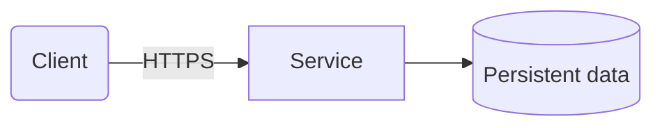

# Write repository diagrams

Read [`tools/mermaid/README.md`](../../README.md) for the theme contract and the
measured reasons behind each setting before changing a diagram that depends on
one of them.

## Use the diagram macro by default

Declare maintained non-blog diagrams with `mermaid_diagram`. It generates
light and dark SVG and WebP files from one source and uses the site theme by
default. Documentation uses the SVG pair. Raster consumers can select one
WebP variant.

```starlark
load("//projects/alwaldend.com/pkg/mermaid:defs.bzl", "mermaid_diagram")

mermaid_diagram(
    name = "architecture",
    src = "architecture.mmd",
    out = "rendered/architecture",
)

docs_filegroup(
    name = "docs_assets",
    srcs = [":architecture_svg"],
    prefix = "content/docs/<package>/assets",
)
```

Build `:architecture` for all four files, `:architecture_svg` for both SVGs,
`:architecture_webp` for the light WebP, or `:architecture_dark_webp` for the
dark WebP. Reference the light SVG in Markdown or the SVG shortcode so the
site can select its `.dark.svg` sibling in dark mode. For README documentation,
point the image at the path `docs_filegroup` publishes.

Blog posts use individual render rules and keep generated images beside
`index.md`. Use `write_source_files` to copy the selected render into
the post package, publish it through `docs_filegroup`, and run the generated
freshness tests. A diagram shared by documentation and a historical blog
keeps one `.mmd` source and the blog's original render.

Other consumers that require a checked-in image can also use
`write_source_files`. Document the consumer's reason in its package. Keep the
`.mmd` authoritative and edit it to update any of the rendered files.

## Render a raster for a service upload

Use the macro's `_webp` or `_dark_webp` target for an upload.
The pinned browser captures the selected SVG with its embedded font and
palette. WebP canvases default to 5:2 with centered, theme-colored padding.
Set `webp_aspect_ratio = []` for natural proportions, or supply another
positive integer width and height. Set `webp_scale = 2` for higher pixel
density. The [X Articles uploader](../../../../projects/x_article_uploader/README.md)
documents accepted media types.

Use an individual render rule for a fixture or comparison that exercises
it directly. For a standalone dark WebP for a blog post, use `mermaid_webp`
with `native = True`, `theme = "//internal/assets:mermaid_theme"`, and
`color_scheme = "dark"`.

## Regular diagrams

A regular infrastructure diagram is a left-to-right Mermaid flowchart
(`flowchart LR`) declared with `mermaid_diagram`.
The site theme supplies classic shapes, curved connectors, fonts, and colors.
The diagram source contains nodes, arrows, and labels.

Use rectangles for services, rounded nodes for people or clients, and
cylinders for persistent stores. Group nodes when they share a deployment
boundary such as a VM or network. Use short node labels and label edges
with a protocol, action, or payload when it helps explain the flow. Use
solid arrows for the primary flow and dotted arrows for secondary flows
such as configuration.



## Default to Dagre and `flowchart LR`

The shared theme selects Dagre. Write `flowchart LR` for left-to-right flow
unless the diagram or the user calls for another direction. Direction is
declared in the source, not forced by the theme. Dagre's `nodeSpacing` and
`rankSpacing` adjust spacing, but do not guarantee a maximum canvas width.

Subgraph directions are ignored when internal nodes connect outside the group;
switching between Dagre and ELK does not fix that case. Verify the actual
render before claiming that groups follow their declared direction.

## Keep theme changes in `tools/mermaid/theme.json`

The theme owns appearance, so a diagram carries structure and labels only. A
diagram that needs a different look should not carry a local `themeCSS` block:
change the theme when the look should apply everywhere.

A diagram may still override a specific key with a Mermaid directive, because
Mermaid merges a directive over the file config:

```text
%%{init: {"look": "classic"}}%%
flowchart LR
    a[Square] --> b(Rounded)
```

Shapes stay semantic. `()` and the other inherently rounded shapes render
rounded, `[]` renders as a sketched rectangle, and nothing forces every node
into one outline. Pick the shape for what the node means rather than for the
look.

Keep nested container titles short and retain the shared title styling. Dagre
uses a fixed inset between nested containers, so the theme lifts title plates
to avoid overlap. Verify title and container containment from the rendered SVG
rather than assuming that a successful render has readable geometry.

## Render hermetically

The theme is applied by default, both entry points pin Chrome, and both expose
only the repository's pinned fonts through Fontconfig. Never add a CDN script,
a `<script type="module">` import, a downloaded font, or a network fetch to a
diagram or theme: rendering must resolve everything from the Bazel graph.

The height of hermeticity is the whole pipeline, not just the render. A themed
output also embeds the pinned handwriting face, because a page that shows the
SVG through `` cannot see the page's webfonts and would otherwise lay the
text out in a wider system font than the renderer measured. Do not remove that
embedding or reintroduce a webfont dependency, and do not hand a viewer a
diagram whose labels only fit when a particular font happens to be installed.

Set `plain = True` on `mermaid_svg`, or `MERMAID_PLAIN=1` for `mmdc`, to render
Mermaid's own defaults for comparison. That output is neither themed nor
hermetic by design; never publish or commit it.

When a consumer has to publish an upstream-appearance comparison, use
`theme = "//tools/mermaid:upstream-theme.json"` instead: it shows Mermaid's own
appearance while keeping the render hermetic. The post at
`//projects/alwaldend.com/content/blog/diagrams-in-ac-era` is the worked
example.

For an interactive render, `mmdc` needs absolute paths because the launcher
runs from Bazel's output tree:

```sh
repo_root="$PWD"
bazel run //tools/mermaid:mmdc -- \
  -i "${repo_root}/path/to/diagram.mmd" \
  -o "${repo_root}/path/to/diagram.svg"
```

`mmdc` applies the same theme, pinned fonts, and paint-order fix as a build
action, so an interactive render matches the committed one. It writes only the
file named by `-o` or `--output`, so an SVG printed to stdout is not rewritten.
Always re-render a maintained diagram through its `mermaid_svg` target before
handoff, which is the only path a build action verifies.

## Verify

Render the diagram and inspect the output rather than the source. A change is
complete when the container titles are readable, no title escapes its parent
container, and no edge crosses a title plate. `//tools/mermaid/test/renderer`
holds the fixtures that pin these properties; extend them when a change
introduces a new condition.
